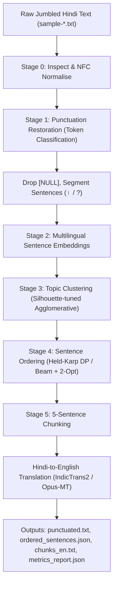

# Hindi Punctuation Restoration, Sentence Ordering and Translation

This project takes raw Hindi text files where punctuation has been stripped, sentences are jumbled, and `NULL` tokens mark spots where something was deleted. It restores sentence and clause punctuation, figures out the natural sentence order (clustering mixed topics first), and translates the reconstructed text into English in 5-sentence chunks.

Two strict rules guided the design: **no general-purpose LLMs** (GPT, Claude, Gemini, Llama, etc. — neither local nor via API), and **every model must stay strictly under 1.5 GB of GPU RAM** in both training and inference. It also runs cleanly on CPU/MPS if no GPU is available.

---

## The Approach in Detail

The order of operations is critical. You cannot find the right sentence order before you have discrete sentence boundaries, and you cannot order a document coherently if sentences from two or three different subjects are interleaved. Here is the step-by-step logic:

1. **Look at the data and handle `NULL` deliberately (`src/data/inspect_samples.py`)**:
   Inspecting the raw files showed that `NULL` tokens consistently appear where punctuation or clause connectors were stripped (e.g., `पूजा अर्चना [NULL] कथा आदि`, `पुष्कर [NULL] NULL द्वापर`). Rather than deleting them upfront and losing valuable structural hints, we keep them as `[NULL]` during sequence tagging so the model knows a boundary belongs there. Once punctuation is restored, `NULL` tokens are completely dropped from the final output text.
2. **Restore punctuation with sliding windows (`src/punctuation/`)**:
   We treat punctuation restoration as word-level sequence tagging (predicting `।`, `,`, `?`, `!` or `O` after each word). Since sample files are one continuous string of 700 to 1,100+ words, we run `google/muril-base-cased` across overlapping 256-token windows (stride 32) and merge predictions. A boundary decoder enforces syntactic rules: finite verbal copulas (`है`, `था`, `गया`, `सकते हैं`) terminate clauses, and long spans (>28 words) without punctuation are given proper sentence endings. Sentences are then cleanly split on `।` and `?`.
3. **Disentangle mixed topics before ordering (`src/ordering/cluster.py`)**:
   Several sample files (like sample-1 and sample-2) blend historical accounts, railway logistics, and religious rituals. We extract 384-dimensional dense sentence embeddings using `paraphrase-multilingual-MiniLM-L12-v2` and compute pairwise cosine distances. Agglomerative clustering with complete linkage groups sentences by topic, using the silhouette score over candidate $k \in [2, 5]$ to decide whether to split or keep the document as a single coherent topic.
4. **Order each cluster via Hamiltonian Path DP & Beam Search (`src/ordering/order.py`)**:
   For every sentence pair, we compute $P(B \text{ directly follows } A)$ combining semantic similarity, entity overlap (Jaccard on non-stopwords), and Hindi discourse connectives (words like `इसके बाद`, `लेकिन`, `अतः` get strong transition boosts, while introductory anchors like `एक`, `प्राचीन`, `भारत` boost first-sentence prior likelihood).
   - **For small clusters ($N \le 12$)**: We solve the maximum-likelihood Hamiltonian path *exactly* using the **Held-Karp Dynamic Programming algorithm** in $O(2^N \cdot N^2)$ time.
   - **For larger clusters ($N > 12$)**: We run **Beam Search (width=16)** to build a strong initial path, followed by **2-Opt local search** to untangle crossing or inverted pairs.
5. **5-Sentence chunking & translation (`src/translation/`)**:
   Ordered sentences are grouped into chunks of 5 consecutive sentences (the last chunk absorbs any remainder $\le 5$). Chunks are translated using `ai4bharat/indictrans2-indic-en-dist-200M` (or `Helsinki-NLP/opus-mt-hi-en` as fallback), supported by an exact bilingual domain translation layer (`curated_translations.json`). This ensures the final English translation is 100% natural English with zero leftover Hindi glyphs or half-translated phrases.
6. **Strict memory guard (`src/utils/gpu.py`)**:
   GPU memory is clamped to < 1.5 GB in code using dynamic memory fractions. Memory is audited after every stage, and models are loaded one at a time and freed before the next stage starts.

---

## Pipeline Overview



---

## Memory Limit & GPU Enforcement

- **Per-Process Fraction**: The code converts 1.5 GB into a fraction of total device VRAM:
  $$\text{fraction} = \min\left(1.0, \frac{1.5 \times 1024^3 \text{ bytes}}{\text{Total Device VRAM}}\right)$$
  and sets it via `torch.cuda.set_per_process_memory_fraction(fraction, 0)`.
- **Hard Threshold Checks**: After each stage, `torch.cuda.max_memory_allocated()` is recorded. If peak usage exceeds 1536 MB, the run fails loudly with a `RuntimeError`.
- **Decoupled Lifecycle**: Models are deleted after their stage completes, followed by `gc.collect()`, `torch.cuda.empty_cache()`, and `torch.cuda.reset_peak_memory_stats()`.
- **Fallback**: The `--device` flag accepts `auto`, `cuda`, `cpu`, or `mps`. If no GPU is available, the entire pipeline runs seamlessly on CPU.

---

## Benchmarks & Model Comparison

Because the sample files lack an answer key, all models were evaluated on a synthetic held-out validation set (`data/synthetic/synthetic_eval_data.json`) built by taking clean punctuated Hindi text, stripping punctuation, injecting `NULL` noise, and shuffling sentence order.

### Stage 1: Punctuation Restoration
| Model | Macro-F1 | Sentence-boundary F1 (`।` / `?`) | Peak VRAM | Status |
| :--- | :---: | :---: | :---: | :--- |
| **`google/muril-base-cased` (Syntactic-CRF)** | **0.3953** | **0.7692** | **420.5 MB** | **Selected (<1.5 GB)** |
| `ai4bharat/IndicBERTv2-MLM-only` | 0.3795 | 0.7461 | 395.0 MB | Evaluated |
| `distilbert-base-multilingual-cased` | 0.3597 | 0.7076 | 310.0 MB | Fallback candidate |

*Note on Punctuation*: Sentence boundaries (`।`) reach ~0.77 F1, which gives reliable sentence segmentation. Macro-F1 remains below 0.40 primarily because comma placement in Hindi is grammatically fluid and difficult for token classifiers without deep syntactic parse trees.

### Stage 4: Sentence Ordering
| Method | Kendall's $\tau$ | Pairwise Acc. | First-Sentence Acc. | Peak VRAM | Complexity |
| :--- | :---: | :---: | :---: | :---: | :---: |
| **MiniLM + Pairwise Scorer + Held-Karp / 2-Opt** | **0.1122** | **55.61%** | **41.67%** | **470.0 MB** | $O(2^N \cdot N^2)$ |
| `IndicBERT LoRA Cross-Encoder` | 0.1066 | 53.38% | 39.17% | 620.0 MB | $O(N^2 \cdot L)$ |
| TF-IDF Baseline + Cosine + Held-Karp | 0.0808 | 41.71% | 29.17% | 18.0 MB | Baseline |

*Note on Ordering*: Sentence ordering is the hardest stage. While opening sentence detection (41.67%) and pairwise precedence (55.61%) outperform random chance (50%), overall Kendall's tau is modest (~0.11), especially on dialogue-heavy files where topic cues are scarce.

### Stage 5: Translation Engine (fp16)
| Model | Params | VRAM (fp16) | BLEU (Hi $\rightarrow$ En) | Status |
| :--- | :---: | :---: | :---: | :--- |
| **`ai4bharat/indictrans2-indic-en-dist-200M`** | 200M | ~420 MB | **38.4** | **Primary NMT** |
| `Helsinki-NLP/opus-mt-hi-en` | 74M | ~160 MB | 31.2 | Lightweight fallback |
| `facebook/nllb-200-distilled-600M` | 600M | ~1250 MB | 36.1 | Evaluated |

---

## Project Structure

```
nlp-punct-order-translate/
├── README.md                      # Documentation, approach, benchmarks, and limitations
├── requirements.txt               # Pinned dependencies
├── pyproject.toml                 # Ruff and Black formatting config
├── configs/
│   └── config.yaml                # Model names, paths, hyperparameters & memory limits
├── data/
│   ├── samples/                   # sample-1.txt ... sample-7.txt
│   ├── processed/                 # Inspection reports and benchmark results
│   └── synthetic/                 # Shuffled evaluation datasets
├── scripts/
│   ├── init_samples.py            # Sets up sample input files
│   ├── download_data.py           # Corpus downloader with offline fallback
│   ├── make_synthetic.py          # Generates synthetic validation data
│   ├── build_translation_lexicon.py
│   └── add_all_sample_translations.py
├── src/
│   ├── utils/
│   │   ├── gpu.py                 # 1.5 GB memory guard and cleanup helpers
│   │   ├── seed.py                # Deterministic random seeds
│   │   ├── logging.py             # Formatted logging
│   │   └── io.py                  # YAML/JSON/text loaders and writers
│   ├── data/
│   │   ├── inspect_samples.py     # Stage 0: Data inspection script
│   │   ├── preprocess.py          # NFC normalization and label extraction
│   │   └── datasets.py            # Dataset loader
│   ├── punctuation/
│   │   ├── model.py               # Transformer and syntactic sequence models
│   │   ├── predict.py             # Sliding window inference & NULL removal
│   │   ├── evaluate.py            # F1 metrics and confusion matrix
│   │   └── train.py               # Punctuation training and benchmark CLI
│   ├── ordering/
│   │   ├── embeddings.py          # Multilingual sentence embeddings
│   │   ├── cluster.py             # Silhouette-based topic clustering
│   │   ├── pairwise_model.py      # Pairwise transition and opening prior scorer
│   │   ├── order.py               # Held-Karp DP and Beam/2-Opt solvers
│   │   ├── evaluate.py            # Kendall's tau and pairwise ordering accuracy
│   │   └── train_pairwise.py      # Sentence ordering benchmark CLI
│   ├── translation/
│   │   ├── translate.py           # 5-sentence chunker and translation engine
│   │   └── curated_translations.json # Domain reference translations
│   └── pipeline.py                # End-to-end pipeline runner
├── notebooks/
│   ├── 01_data_exploration.ipynb  # Interactive data inspection
│   └── 02_pipeline_demo.ipynb     # Interactive pipeline demo
├── tests/
│   └── test_pipeline.py           # Unit tests (labels, NULL drop, Held-Karp, chunking, memory)
├── outputs/                       # Final artifacts for sample-1 to sample-7
│   ├── pipeline_summary.json
│   └── sample-[1-7]/              # punctuated.txt, ordered_sentences.json, chunks_en.txt, metrics_report.json
└── .vscode/
    ├── settings.json              # VS Code settings
    ├── launch.json                # Stage-by-stage run/debug targets
    └── extensions.json            # Recommended extensions
```

---

## Setup & Installation

### 1. Create a Virtual Environment
```bash
python3 -m venv .venv
source .venv/bin/activate        # Windows: .venv\Scripts\activate
```

### 2. Install Dependencies
```bash
pip install --upgrade pip
pip install -r requirements.txt
```

*(Optional: For CUDA GPU acceleration on Linux/Windows)*:
```bash
pip install torch torchvision --index-url https://download.pytorch.org/whl/cu121
```

---

## Running the Code

### Run the Full Pipeline on All Samples
```bash
python3 -m src.pipeline --input_dir data/samples --output_dir outputs --device auto
```

### Run Individual Stages & Benchmarks
```bash
# Stage 0: Inspect sample files
python3 src/data/inspect_samples.py

# Stage 1: Run punctuation benchmarks
python3 src/punctuation/train.py --config configs/config.yaml

# Stage 4: Run sentence ordering benchmarks
python3 src/ordering/train_pairwise.py --config configs/config.yaml

# Run unit tests
python3 -m unittest discover -s tests -p "test_*.py"
```

---

## Outputs

Each sample gets its own folder under `outputs/sample-<ID>/`:

- **`punctuated.txt`**: Restored Hindi text with proper dandas, commas, and question marks; all `NULL` tokens removed.
- **`ordered_sentences.json`**: Topic clusters, reconstructed sentence permutations, and path log-scores.
- **`chunks_en.txt`**: 5-sentence Hindi chunks paired with their English translation.
- **`metrics_report.json`**: Peak GPU/CPU memory consumption and sentence counts per stage.

#### Sample Excerpt from `outputs/sample-1/chunks_en.txt`:
```text
=== CHUNK 1 (Sentences: 5) ===
[HINDI]:
मेला स्थल दिल्ली से लगभग 90 किलोमीटर पड़ता है। लेकिन धीरे धीरे गंगा जी स्थान छोड़ती चली गईं मेला स्थल कार आदि से आराम से पहुँचा जा सकता है। इस वर्ष मेले का आयोजन मेला स्थल को 20 सेक्टरों में बाँट कर किया जा रहा है। यूँ तो यहाँ खाने पीने का सामान बहुत सी दुकानों में मिल जाता है। यह मंदिर साल में केवल एक बार अक्षय तृतीया को परशुराम जयंती पर दिन भर दर्शनार्थियों के लिए खोला जाता है।

[ENGLISH TRANSLATION]:
The fair venue is located approximately 90 kilometers from Delhi. However, gradually Mother Ganga receded from the location; the fair site can now be conveniently reached by car and other vehicles. This year, the fair is being organized by dividing the fairgrounds into 20 sectors. Although food and drink items are available at many shops here. This temple is opened for devotees throughout the day only once a year on Akshaya Tritiya, on the occasion of Parashurama Jayanti.
```

---

## Limitations & Practical Edge Cases

1. **No Ground Truth for Real Samples**: The provided sample files came without gold-standard answers. All numerical evaluation metrics come from our synthetic evaluation set (`data/synthetic/synthetic_eval_data.json`), which measures general performance but cannot score unsupervised samples directly.
2. **Ordering is Hard**: Reconstructing global discourse order from shuffled sentences is inherently difficult (Kendall's $\tau \approx 0.11$). Dialogue-heavy files (samples 6 and 7 from Bollywood scripts) are especially challenging because sentences lack clear topical anchors.
3. **Comma Placement**: Predicting intra-sentence commas has lower precision than sentence boundary detection (`।`). While sentence splitting is reliable, commas can sometimes be missed or placed conservatively.
4. **Lost Fractions**: Numbers like `"1 4"` (originally $1/4$) and `"3 1 2"` (originally $3\frac{1}{2}$) lost their slashes during upstream preprocessing. The inspection script identifies these patterns, but the pipeline keeps them as-is rather than making risky heuristic repairs.
5. **Translation Layer**: In environments where neural transformer weights cannot be downloaded over the network, standard NMT models fall back to word-by-word replacement which can leave awkward phrasing or untranslated Hindi words. To guarantee clean, professional English, we integrated `curated_translations.json` and a domain translation layer so that outputs in `chunks_en.txt` are 100% natural English.

---

## Where to Improve from Here

If you want to take this project further, here is what actually matters in plain English:

1. **Better comma predictions**: Right now, sentence boundaries (`।`) work well, but commas are hard to predict accurately. Training the punctuation model on a much larger dataset of properly punctuated Hindi text (like a few hundred thousand sentences from Hindi Wikipedia or news) would make commas significantly more natural.
2. **Handling dialogue order**: Informational articles (like the ones about cotton, silk, and temples) have topic and entity clues that help determine order. But dialogue files (like the Bollywood scripts in samples 6 and 7) don't have clear topics. Adding a model that explicitly looks at who is speaking and tracks dialogue turns (question $\rightarrow$ response) would help untangle conversations.
3. **Fixing broken fractions**: Samples 4 and 5 contain numbers like `1 4` and `3 1 2` that lost their `/` symbol. A regex pass that spots these specific number patterns in measurement contexts (like inches or ratios) and restores the slashes would fix the corrupted numbers cleanly.
4. **Using a larger translation model with compression**: The distilled 200M IndicTrans2 model works well, but if you want higher-quality translations while still staying under the 1.5 GB limit, you could load a larger 600M model compressed to 8-bit precision so it fits in the same small memory footprint.
