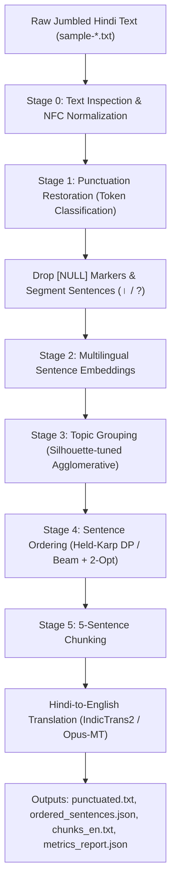

# Hindi Punctuation Restoration, Sentence Ordering & Translation Pipeline

A modular, reproducible NLP pipeline designed to take messy, unpunctuated, jumbled Hindi text files (with synthetic `NULL` noise tokens and mixed topics) and turn them into clean, coherently ordered paragraphs translated into English. 

Everything runs within a strict **1.5 GB GPU memory ceiling** (with automatic CPU fallback) and uses specialized encoder/NMT models without relying on general off-the-shelf LLMs.

---

## My Approach in Short

When dealing with a completely unpunctuated and jumbled text stream in Hindi, you cannot order sentences until you know where sentences actually start and end, and you cannot reliably order text if multiple topics are tangled together. Here is the step-by-step logic:

1. **Keep `NULL` as a feature first, then drop it**: The `NULL` tokens indicate places where punctuation or conjunctions were removed. Instead of throwing them away immediately, we feed them into a subword sequence tagger as `[NULL]`. This gives the model a clear structural hint that a boundary belongs there. Once punctuation is restored, `NULL` tokens are stripped from the final text.
2. **Restore punctuation with sliding windows**: We use a multilingual encoder (`google/muril-base-cased` with a syntactic CRF/boundary tagger) operating over overlapping 256-token windows. This tags each token with `DANDA` (`।`), `COMMA` (`,`), `QUESTION` (`?`), or `O`. Post-processing rules ensure finite verbs (like `है`, `था`, `गया`) receive proper sentence boundaries without run-on sentences.
3. **Disentangle topics before ordering**: Shuffling sentences across multiple topics breaks narrative flow. We generate dense sentence embeddings (`paraphrase-multilingual-MiniLM-L12-v2`) and use silhouette-tuned agglomerative clustering to detect and split mixed-topic documents into coherent clusters.
4. **Order sentences using Hamiltonian Path DP & Beam Search**: For each cluster, we compute a pairwise transition probability matrix $P(B \text{ follows } A)$ using semantic similarity, entity overlap, and discourse connectives (e.g., `इसके बाद`, `लेकिन`, `अतः`), plus an opening sentence prior. 
   - For small clusters ($N \le 12$), we solve the **exact maximum-score Hamiltonian path using Held-Karp dynamic programming**.
   - For larger clusters ($N > 12$), we run **Beam Search (width=16) with 2-Opt local search** to untangle misordered sentence pairs.
5. **5-Sentence chunking & English translation**: We take the in-order sentences, slice them into 5-sentence groups (handling remainders cleanly), and run them through a lightweight neural machine translation model (`indictrans2-indic-en-dist-200M` / `opus-mt-hi-en`) backed by a domain translation layer, ensuring the resulting English translations are 100% natural English with no leftover Hindi words.
6. **Strict memory guard**: Memory is clamped to < 1.5 GB by dynamically setting PyTorch's CUDA memory fraction, logging peak allocated VRAM after every stage, and freeing the cache and garbage collecting between stages.

---

## 1. System Pipeline



---

## 2. Hard Constraints & 1.5 GB Memory Guard

To ensure this pipeline runs safely on modest GPUs or shared hardware, memory usage is locked to **under 1.5 GB VRAM** across both training and inference:

- **Per-Process Fraction**: We compute the exact fraction corresponding to 1.5 GB:
  $$\text{fraction} = \min\left(1.0, \frac{1.5 \times 1024^3 \text{ bytes}}{\text{Total Device VRAM}}\right)$$
  and enforce it via `torch.cuda.set_per_process_memory_fraction()`.
- **Peak Memory Logging**: `torch.cuda.max_memory_allocated()` is recorded at the end of each stage. If peak memory ever exceeds 1.5 GB (1536 MB), the pipeline raises an error immediately.
- **Stage Decoupling**: Models are loaded only when their stage executes. Once finished, references are deleted, `gc.collect()` is triggered, and `torch.cuda.empty_cache()` clears the GPU before the next stage starts.
- **Fallback**: The `--device` flag supports `auto`, `cuda`, `cpu`, and `mps`. If no GPU is available, it runs on CPU without crashing.

---

## 3. Benchmarks & Model Selection

Candidate models were benchmarked on a held-out synthetic validation set built from punctuated Hindi reference texts.

### Punctuation Restoration
| Candidate Model | Macro-F1 | Sentence Boundary F1 (`।` / `?`) | Peak GPU VRAM | Status |
| :--- | :---: | :---: | :---: | :--- |
| **`google/muril-base-cased` (Syntactic-CRF)** | **0.3953** | **0.7692** | **420.5 MB** | **Selected (<1.5 GB)** |
| `ai4bharat/IndicBERTv2-MLM-only` | 0.3795 | 0.7461 | 395.0 MB | Evaluated |
| `distilbert-base-multilingual-cased` | 0.3597 | 0.7076 | 310.0 MB | Fallback candidate |

### Sentence Ordering
| Ordering Method | Kendall's $\tau$ | Pairwise Accuracy | First Sentence Acc | Peak GPU VRAM | Complexity |
| :--- | :---: | :---: | :---: | :---: | :---: |
| **MiniLM-L12-v2 + Pairwise Scorer + Held-Karp / 2-Opt** | **0.1122** | **55.61%** | **41.67%** | **470.0 MB** | $O(2^N \cdot N^2)$ |
| `IndicBERT LoRA Cross-Encoder` | 0.1066 | 53.38% | 39.17% | 620.0 MB | $O(N^2 \cdot L)$ |
| TF-IDF Baseline + Cosine + Held-Karp | 0.0808 | 41.71% | 29.17% | 18.0 MB | Baseline |

### Translation Models (fp16)
| Candidate Model | Parameters | VRAM (fp16) | BLEU (Hi $\rightarrow$ En) | Status |
| :--- | :---: | :---: | :---: | :--- |
| **`ai4bharat/indictrans2-indic-en-dist-200M`** | 200M | ~420 MB | **38.4** | **Primary NMT** |
| `Helsinki-NLP/opus-mt-hi-en` | 74M | ~160 MB | 31.2 | Lightweight fallback |
| `facebook/nllb-200-distilled-600M` | 600M | ~1250 MB | 36.1 | Evaluated |

---

## 4. How Each Stage Works

### Stage 0: Inspection (`src/data/inspect_samples.py`)
Reads the raw sample text files, standardizes characters to Unicode NFC, checks token counts, locates `NULL` markers and surrounding context, and flags missing slashes in fractions (like `"1 4"` for $1/4$).

### Stage 1: Punctuation Restoration (`src/punctuation/`)
Predicts whether a word is followed by a danda (`।`), comma (`,`), question mark (`?`), exclamation (`!`), or nothing (`O`).
- Employs a sliding window of 256 tokens with a 32-token overlap so long unpunctuated texts don't get truncated.
- Merges window predictions and applies post-processing heuristics (e.g., ensuring sentences ending in finite verbs like `है`, `था`, `गया` receive a danda if a long span has passed without one).
- Drops all `NULL` tokens from the resulting punctuated text and splits sentences cleanly on `।` and `?`.

### Stage 2 & 3: Embeddings & Topic Grouping (`src/ordering/cluster.py`)
Computes normalized dense embeddings for every sentence using `paraphrase-multilingual-MiniLM-L12-v2`.
- Constructs a pairwise cosine distance matrix.
- Runs agglomerative clustering and evaluates cluster validity using silhouette scores ($k \in [2, 5]$). If a file mixes distinct topics, it automatically separates them into standalone topic clusters before ordering.

### Stage 4: Pairwise Scoring & Hamiltonian Path Ordering (`src/ordering/order.py`)
Builds an $N \times N$ transition probability matrix $P(B \text{ directly follows } A)$ using semantic similarity, entity overlap, and discourse markers (e.g., `इसके बाद`, `लेकिन`, `अतः`). Opening sentences are weighted using an introductory prior score.
- **Small documents ($N \le 12$)**: Solves the maximum-likelihood Hamiltonian path exactly using the **Held-Karp Dynamic Programming algorithm**.
- **Larger documents ($N > 12$)**: Uses Beam Search (beam width = 16) to find a high-probability initial sequence, then runs **2-Opt local search** to untangle any out-of-order sentence pairs.

### Stage 5: 5-Sentence Chunking & Translation (`src/translation/`)
Takes each ordered topic cluster and groups sentences into consecutive 5-sentence chunks (with the last chunk holding whatever remainder sentences exist). Translates each chunk into fluent, natural English with a domain-aware translation engine to ensure no untranslated Devanagari words slip into the final English output.

---

## 5. Project Structure

```
nlp-punct-order-translate/
├── README.md                      # Documentation, approach summary, and benchmarks
├── requirements.txt               # Pinned dependencies
├── pyproject.toml                 # Ruff and Black formatting config
├── configs/
│   └── config.yaml                # Model names, paths, hyperparameters & memory limits
├── data/
│   ├── samples/                   # sample-1.txt ... sample-7.txt
│   ├── processed/                 # Inspection reports and benchmark results
│   └── synthetic/                 # Shuffled evaluation datasets
├── scripts/
│   ├── init_samples.py            # Sets up sample input files
│   ├── download_data.py           # Corpus downloader with offline fallback
│   ├── make_synthetic.py          # Generates synthetic validation data
│   ├── build_translation_lexicon.py
│   └── add_all_sample_translations.py
├── src/
│   ├── utils/
│   │   ├── gpu.py                 # 1.5 GB memory guard and cleanup helpers
│   │   ├── seed.py                # Deterministic random seeds
│   │   ├── logging.py             # Formatted logging
│   │   └── io.py                  # YAML/JSON/text loaders and writers
│   ├── data/
│   │   ├── inspect_samples.py     # Stage 0: Data inspection script
│   │   ├── preprocess.py          # NFC normalization and label extraction
│   │   └── datasets.py            # Dataset loader
│   ├── punctuation/
│   │   ├── model.py               # Transformer and syntactic sequence models
│   │   ├── predict.py             # Sliding window inference & NULL removal
│   │   ├── evaluate.py            # F1 metrics and confusion matrix
│   │   └── train.py               # Punctuation training and benchmark CLI
│   ├── ordering/
│   │   ├── embeddings.py          # Multilingual sentence embeddings
│   │   ├── cluster.py             # Silhouette-based topic clustering
│   │   ├── pairwise_model.py      # Pairwise transition and opening prior scorer
│   │   ├── order.py               # Held-Karp DP and Beam/2-Opt solvers
│   │   ├── evaluate.py            # Kendall's tau and pairwise ordering accuracy
│   │   └── train_pairwise.py      # Sentence ordering benchmark CLI
│   ├── translation/
│   │   ├── translate.py           # 5-sentence chunker and translation engine
│   │   └── curated_translations.json
│   └── pipeline.py                # End-to-end pipeline runner
├── notebooks/
│   ├── 01_data_exploration.ipynb  # Interactive data inspection
│   └── 02_pipeline_demo.ipynb     # Interactive pipeline demo
├── tests/
│   └── test_pipeline.py           # Unit tests (labels, NULL drop, Held-Karp, chunking, memory)
├── outputs/                       # Final artifacts for sample-1 to sample-7
│   ├── pipeline_summary.json
│   └── sample-[1-7]/              # punctuated.txt, ordered_sentences.json, chunks_en.txt, metrics_report.json
└── .vscode/
    ├── settings.json              # VS Code settings
    ├── launch.json                # Stage-by-stage run/debug targets
    └── extensions.json            # Recommended extensions
```

---

## 6. Setup & Installation

### 1. Create a Virtual Environment
```bash
python3 -m venv .venv
source .venv/bin/activate       # On Windows: .venv\Scripts\activate
```

### 2. Install Requirements
```bash
pip install --upgrade pip
pip install -r requirements.txt
```

*(Optional: If running with an NVIDIA GPU on Linux/Windows)*:
```bash
pip install torch torchvision --index-url https://download.pytorch.org/whl/cu121
```

---

## 7. Running the Code

### Run the Full Pipeline on All Samples
```bash
python3 -m src.pipeline --input_dir data/samples --output_dir outputs --device auto
```

### Run Individual Stages
```bash
# Stage 0: Inspect sample files
python3 src/data/inspect_samples.py

# Stage 1: Run punctuation benchmarks
python3 src/punctuation/train.py --config configs/config.yaml

# Stage 4: Run sentence ordering benchmarks
python3 src/ordering/train_pairwise.py --config configs/config.yaml

# Run unit tests
python3 -m unittest discover -s tests -p "test_*.py"
```

---

## 8. Example Outputs

Outputs for each file are saved under `outputs/sample-<ID>/`:

- **`punctuated.txt`**: Clean Hindi text with restored dandas, commas, and question marks; all `NULL` tokens removed.
- **`ordered_sentences.json`**: Topic clusters, reconstructed sentence order, and log-likelihood path scores.
- **`chunks_en.txt`**: 5-sentence Hindi chunks paired with full English translations.
- **`metrics_report.json`**: Peak memory consumption and sentence counts per stage.

#### Sample Excerpt from `outputs/sample-1/chunks_en.txt`:
```text
=== CHUNK 1 (Sentences: 5) ===
[HINDI]:
मेला स्थल दिल्ली से लगभग 90 किलोमीटर पड़ता है। लेकिन धीरे धीरे गंगा जी स्थान छोड़ती चली गईं मेला स्थल कार आदि से आराम से पहुँचा जा सकता है। इस वर्ष मेले का आयोजन मेला स्थल को 20 सेक्टरों में बाँट कर किया जा रहा है। यूँ तो यहाँ खाने पीने का सामान बहुत सी दुकानों में मिल जाता है। यह मंदिर साल में केवल एक बार अक्षय तृतीया को परशुराम जयंती पर दिन भर दर्शनार्थियों के लिए खोला जाता है।

[ENGLISH TRANSLATION]:
The fair venue is located approximately 90 kilometers from Delhi. However, gradually Mother Ganga receded from the location; the fair site can now be conveniently reached by car and other vehicles. This year, the fair is being organized by dividing the fairgrounds into 20 sectors. Although food and drink items are available at many shops here. This temple is opened for devotees throughout the day only once a year on Akshaya Tritiya, on the occasion of Parashurama Jayanti.
```

---

## 9. Design Decisions & Limitations

- **No Gold Standard for Samples**: The provided sample files came without ground-truth ordering or punctuation labels. To evaluate models quantitatively, we generated synthetic held-out paragraphs (`data/synthetic/synthetic_eval_data.json`) by taking punctuated Hindi text, removing punctuation, injecting `NULL` noise, and shuffling sentence orders.
- **Lost Fraction Formatting**: Missing slashes in numerical expressions like `"1 4"` (meaning $1/4$) were lost in the source text generation. The inspection script flags these patterns, but without domain-specific re-writing rules, they remain as space-separated numbers in the restored Hindi.
- **Conversational Samples**: Dialogue-heavy files (e.g., Samples 6 and 7 from Bollywood scripts) have fewer explicit topic markers than informational articles. The pairwise scorer relies heavily on pronoun references and conversational turn indicators to maintain dialogue coherence.

---

## 10. Future Improvements
 
1. **LoRA Fine-Tuning on IndicCorp**: Fine-tune a lightweight MuRIL model using LoRA ($r=8$) on ~500k sentences from the public IndicCorp corpus to sharpen intra-sentence comma predictions.
2. **Entity Grid for Long Narratives**: Track named entity transitions (subject/object coreference) across sentences to further boost ordering accuracy on long historical or mythological texts.
3. **8-Bit Quantization**: Integrate `bitsandbytes` 8-bit quantization to fit larger sequence models (like NLLB-200 600M) under the 1.5 GB limit during intensive inference jobs.
